<p align="center">
  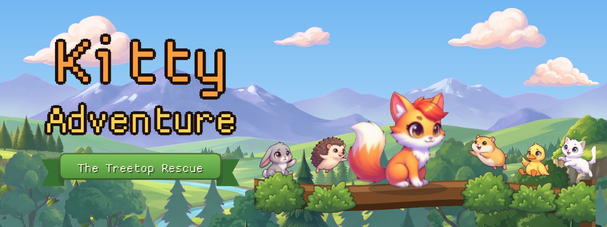
</p>

<h1 align="center">Kitty Adventure</h1>
<h3 align="center">The Treetop Rescue</h3>

<p align="center">
  A cosy climbing platformer: one brave little kitty, bendy branches, and five friends to rescue.
</p>

<p align="center">
  
  
  
  
</p>

<p align="center">
  <a href="https://github.com/kashimakei/kitty_adventure/releases"><b>⬇ Download the Android APK</b></a>
  &nbsp;·&nbsp;
  <a href="#building-it">Build&nbsp;it&nbsp;yourself</a>
</p>

---

## The story

One blustery night a great big wind went whooshing through Whisker Wood and swept Kitty's five
best friends right up into the treetops. In the morning, five little voices are calling down from
the tallest trees. They're much too small to climb down by themselves, so Kitty fluffs up her
tail, looks up, up, up... and starts climbing.

Every level is a stretch of forest three screens wide. Pounce from branch to branch (they bend
and bounce under Kitty like trampolines, and snap if pushed too far), dodge the critters that live
up there, and reach the friend waiting in a nest at the top.

## Screens

<table>
  <tr>
    <td align="center" width="33%">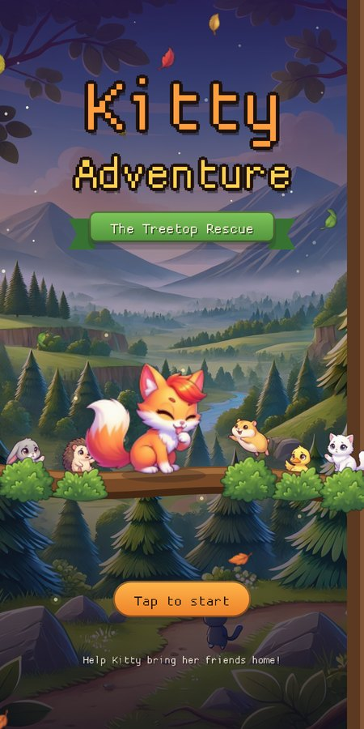<br><sub>Title</sub></td>
    <td align="center" width="33%">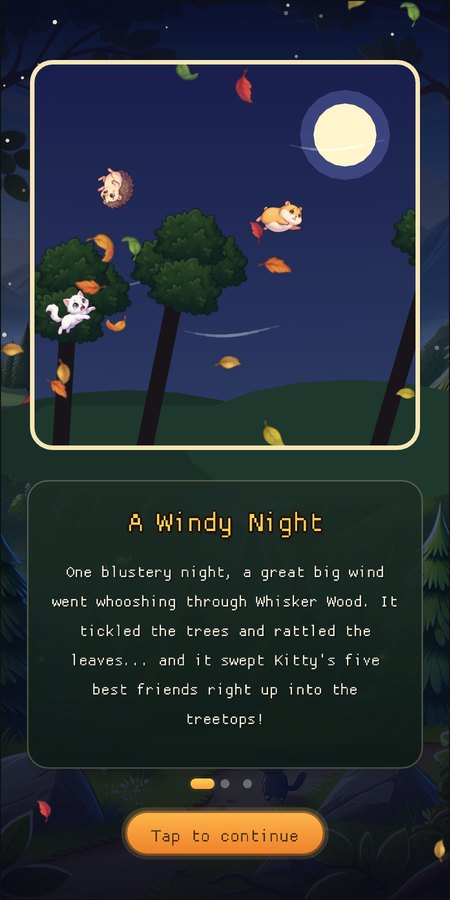<br><sub>A windy night</sub></td>
    <td align="center" width="33%">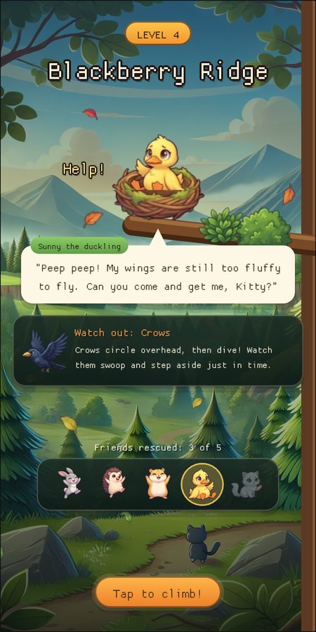<br><sub>Sunny needs help</sub></td>
  </tr>
  <tr>
    <td align="center" width="33%">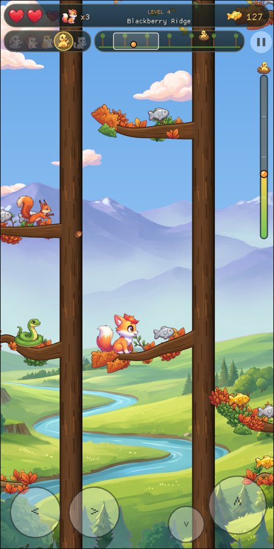<br><sub>Squirrel and snake</sub></td>
    <td align="center" width="33%">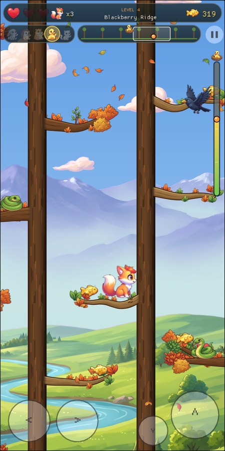<br><sub>Crow and snakes</sub></td>
    <td align="center" width="33%">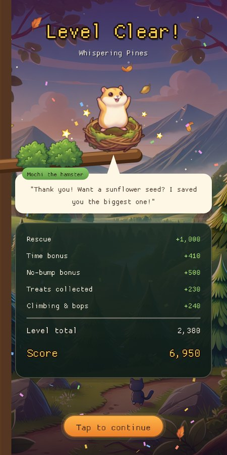<br><sub>Mochi is home!</sub></td>
  </tr>
</table>

## Meet the friends

<table>
  <tr>
    <td align="center" width="20%">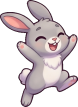</td>
    <td align="center" width="20%">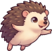</td>
    <td align="center" width="20%"></td>
    <td align="center" width="20%">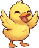</td>
    <td align="center" width="20%"></td>
  </tr>
  <tr>
    <td align="center"><b>Pip</b><br><sub>the&nbsp;bunny</sub></td>
    <td align="center"><b>Hazel</b><br><sub>the&nbsp;hedgehog</sub></td>
    <td align="center"><b>Mochi</b><br><sub>the&nbsp;hamster</sub></td>
    <td align="center"><b>Sunny</b><br><sub>the&nbsp;duckling</sub></td>
    <td align="center"><b>Luna</b><br><sub>the&nbsp;kitten</sub></td>
  </tr>
  <tr>
    <td align="center"><sub>Mossy&nbsp;Hollow</sub></td>
    <td align="center"><sub>Bramble&nbsp;Path</sub></td>
    <td align="center"><sub>Whispering&nbsp;Pines</sub></td>
    <td align="center"><sub>Blackberry&nbsp;Ridge</sub></td>
    <td align="center"><sub>The&nbsp;Tallest&nbsp;Tree</sub></td>
  </tr>
</table>

## Watch out for...

<table>
  <tr>
    <td align="center" width="20%">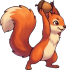</td>
    <td align="center" width="20%">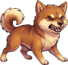</td>
    <td align="center" width="20%"></td>
    <td align="center" width="20%">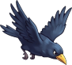</td>
    <td align="center" width="20%">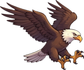</td>
  </tr>
  <tr>
    <td align="center" valign="top"><b>Squirrels</b><br><sub>lob acorns down at&nbsp;Kitty</sub></td>
    <td align="center" valign="top"><b>Dogs</b><br><sub>prowl the ground and leap onto low&nbsp;branches</sub></td>
    <td align="center" valign="top"><b>Snakes</b><br><sub>coil on branches, rear up, then&nbsp;strike</sub></td>
    <td align="center" valign="top"><b>Crows</b><br><sub>fly or perch, then dive beak&#8209;first</sub></td>
    <td align="center" valign="top"><b>Eagles</b><br><sub>screech, glide, then&nbsp;swoop</sub></td>
  </tr>
</table>

A new threat joins on each level, from squirrels on the first to eagles on the fifth. Land on a
squirrel, snake or crow from above to bop it. Every enemy gives a warning before it attacks (a
snarl, a rear, a screech), and only teeth, beaks, claws and acorns hurt.

## How to play

| | On a phone | On a keyboard |
|---|---|---|
| Walk and run | slide a thumb on the left half: the further, the faster | ← → or A D (hold Shift to walk) |
| Jump | hold the right half to crouch, let go to pounce | hold Space, ↑ or W, let go to pounce |
| Climb up when hanging | tap the right half | Space, ↑ or W |
| Let go, or drop through a branch | swipe down on the right half | ↓ or S |
| Pause | the II button, or Back | Esc or P |

- **Charge up.** The longer Kitty crouches, the higher she pounces: the ring at her feet fills
  up, and sparkles when she's ready for her biggest leap. A quick tap is a little hop.
- **Hang on.** Fall just short of a branch and Kitty catches it by the paws; tap to climb up, or
  swipe down to let go.
- **Bounce.** Branches spring like trampolines. Keep holding as Kitty lands and let go as the ring
  glows blue: she rides the rebound higher, and each well-timed bounce goes higher still.
- **But not too high.** Bounce too hard and even a sturdy branch snaps, though it cracks and
  trembles first.
- **Mind the thin ones.** Pale, young branches hold Kitty or a dog, but snap under both, or
  under a bounce from a big leap.
- **Drop through.** Swipe down (or press ↓) while standing on a branch to drop through it to the
  one below.
- **Snack along the way.** Fish treats are worth points, golden fish more, and hearts top Kitty up.
  Kitty has three hearts and three lives.
- **Be quick and careful.** Each rescue scores 1000, plus a time bonus and a bonus for not getting
  bumped. Your best score is saved.

## Features

- Soft-body branches simulated in Rust: they sag, wobble, fork and snap, and Kitty can bounce
  on them like trampolines.
- Touch controls made for thumbs: a floating slider to walk and run, hold and release to pounce,
  swipe down to drop.
- Five story levels with their own friend and threat, then endless rounds that get wilder.
- Three-screen-wide levels with a minimap, and layered parallax scenery: clouds, misty
  mountains, a river valley and a forest that slip away as Kitty climbs.
- Painted sprite characters with pixel-accurate hits: only teeth, beaks, claws and acorns count.
- One codebase for Android, the web and desktop.

## Building it

The game lives in [`mobile/`](mobile/) and is written in Rust with
[macroquad](https://macroquad.rs). With [Rust](https://rustup.rs) installed:

```bash
cd mobile
./build.sh desktop    # play in a window
./build.sh web        # build dist/ (first: rustup target add wasm32-unknown-unknown),
                      # then serve it: python3 -m http.server -d dist 8000
./build.sh android    # build a debug APK (needs the Android SDK, NDK and cargo-ndk)
./build.sh install    # build it, install it on a phone over adb and start it
cargo test --release  # level, physics, touch, squirrel and high-score tests
```

[`mobile/README.md`](mobile/README.md) has the prerequisites, phone setup and how the Android app
is put together.

## Project layout

| Folder | What's in it |
|---|---|
| [`mobile/`](mobile/) | the game (Rust): `src/`, the Android Gradle project, the web page, `build.sh` |
| [`Engines/`](Engines/) | the bendy-branch physics (Rust), shared by both versions of the game |
| [`assets/`](assets/) | characters, pickups, foliage, scenery and sounds; `source/` holds the painted sheets |
| [`tools/`](tools/) | `slice_sprites.py` cuts sprite sheets into frames; `key_layers.py` keys out the scenery |
| [`docs/`](docs/) | images for this page |
| `main.py` | the original pygame prototype (with `entities/`, `systems/`, `constants.py`) |

Kitty, the dogs and the eagles come from the original sprite sheets. The friends, squirrels,
snakes, crows, pickups, foliage and scenery were generated with Google Gemini in the same style,
then keyed out and cut into frames by the scripts in `tools/`. The branch physics come from the
[Rusty-Board](https://github.com/kashimakei/Rusty-Board) engine in `Engines/`.

<details>
<summary><b>The pygame prototype</b></summary>

The game started as a [Pygame](https://www.pygame.org/) prototype, which is still in the
repository root. It needs Python 3.8+, Pygame, and a Rust toolchain to build the branch engine
into your virtualenv:

```bash
pip install -r requirements.txt
cd Engines && maturin develop --release && cd ..
python main.py          # the game
python main.py --test   # the branch physics sandbox (click to drop balls)
python platformer       # a simpler jumping demo
```

Branch feel is tuned in the "Trees & Bendy Branches" section of `constants.py`, and difficulty in
`difficulty_profile()` in `level_utils.py`.

</details>
